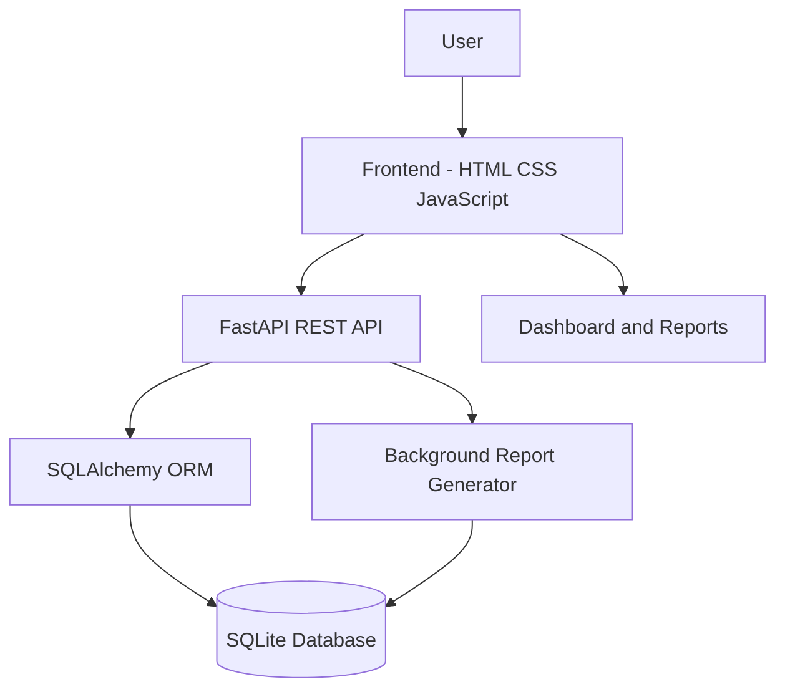

# AgileFlow – System Architecture

## 1. Architecture Overview

AgileFlow follows a simple three-layer architecture:

1. Presentation Layer – HTML, CSS and JavaScript frontend.
2. Application Layer – Python FastAPI backend.
3. Data Layer – SQLite database managed using SQLAlchemy ORM.

## 2. Architecture Diagram

## 3. Component Responsibilities

### Frontend
- Displays dashboard and project information.
- Provides forms to create projects, stories and tasks.
- Sends HTTP requests to the backend.
- Displays API responses and report results.

### Backend
- Handles incoming HTTP requests.
- Validates request data using Pydantic schemas.
- Performs CRUD operations.
- Manages report-generation requests.

### Database
- Stores projects, user stories, tasks, team members and report jobs.
- Maintains relationships using foreign keys.
- Provides persistent storage through SQLite.

### Background Processing
- Generates project summary reports.
- Tracks job status and execution attempts.
- Stores generated report data and errors.

## 4. Request Flow

1. User performs an action on the frontend.
2. JavaScript sends an HTTP request to FastAPI.
3. FastAPI validates the request.
4. SQLAlchemy interacts with SQLite.
5. The backend returns a response.
6. The frontend updates the displayed information.

## 5. Technology Decisions

| Technology | Reason |
|---|---|
| FastAPI | Lightweight REST API framework |
| SQLite | Simple persistent database |
| SQLAlchemy | Database ORM |
| HTML/CSS/JavaScript | Simple frontend implementation |
| BackgroundTasks | Asynchronous report processing |

## 6. Limitations

- No authentication system currently exists.
- BackgroundTasks is not durable if the application process crashes.
- SQLite is intended for a lightweight prototype.
- Production deployment would require stronger security and monitoring.
